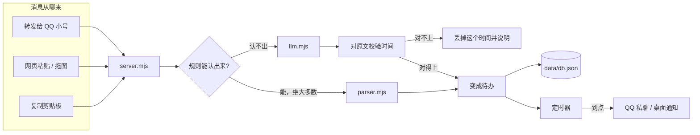

# 待办提醒 · todo-reminder

把群里的通知，变成真的会响的提醒。

---

## 这是什么

群里的通知，你看到了，但没记下来。等到那天过去了才想起来——「哦，昨天有个考试」。

这个项目就是解决这件事的。转发一条消息给它，它把里面的时间抠出来，到点主动叫你。

不用开任何日历 App，不用同步到第三方服务，数据全在你自己的机器上。

---

## 它是怎么用的

你在学校群里看到一条通知：

```
【高等数学】第 3 次平时测验定于 12月5日 19:00-20:30 在线进行，请提前 10 分钟进入
```

截图转发给一个小号 QQ：

```
你：[转发截图]
它： 记下了：高等数学 第 3 次平时测验
     12/5 19:00–20:30
     提醒点：12/4 19:00 · 12/5 18:00 · 12/5 18:45 · 12/5 20:00
```

然后到点它会自己来找你：

```
它： 【1 小时后开考，带好证件】
它： 【15 分钟后开考】
它： 【还剩半小时，检查一下进度】
```

嫌提醒太多或者不够，直接跟它说：

```
你：这场考试九点也提醒我一次
它： 加上了，12/5 21:00 会再叫你一次
```

---

## 两种装法，先选一个

这套东西有两种跑法，代码是同一份，区别只在于**装在哪**。

| | 本地版 | 云端版 |
|---|---|---|
| 装在哪 | 自己的 Windows 电脑 | 一台 Linux 云服务器 |
| 电脑关机后 | 不再提醒 | **照常提醒** |
| 启动方式 | 双击一个 bat | 开机自动跑，不用管 |
| 抓取方式 | 网页粘贴、拖图片、**自动监听剪贴板** | 网页粘贴、转发给 QQ 小号 |
| 图片识别 | 模型直读，失败退回系统 OCR | 模型直读（服务器没有 OCR） |
| 成本 | 免费 | 阿里云 2 核 2G 约 50 天／300 元试用额度 |
| 适合谁 | 想先试试、主要在电脑前干活 | 想随时随地收提醒，我用的就是这个 |

两种可以同时装，但**同一个 QQ 号不能两边同时在线**，只能切换，不能双活。

---

## 装法一：本地版（Windows，五分钟）

### 1. 装 Node

去 [nodejs.org](https://nodejs.org/) 下 LTS 版，装完打开命令行敲 `node -v`，要 **v20.6 以上**。

### 2. 拿到代码

```bash
git clone https://github.com/wu75009-bot/todo-reminder.git todo-reminder
cd todo-reminder
```

没有 git 就点仓库右上角 **Code → Download ZIP**，解压。

### 3. 建配置

```bash
mkdir data
cp config.example.json data/config.json
```

**这时候就能用了。** 不填任何 API Key 也能跑，常见格式的通知纯靠规则就能认出来。

### 4. 启动

双击 `启动.bat`。它会开一个小黑窗口，浏览器自动打开 `http://127.0.0.1:3790`。

不想看到黑窗口，就双击 `后台启动.vbs`——静默运行，什么都不弹。

### 5. 试试

网页上有两个框：**粘贴一段通知文字**，或者**把截图拖进去**。它会解析出待办和全部提醒点，认错了可以直接改。

### 6. 打开剪贴板监听（本地版最省事的一招）

这是本地版才有的功能，**云端版没有**。

在 `data/config.json` 里把这一项改成 `true`：

```json
"clipboard": {
  "enabled": true,
  "autoAdd": true,
  "onlyFromQQ": true
}
```

然后重启服务。之后你在 QQ 里看到通知，**选中文字按 Ctrl+C**，它就自动记下了，连转发都省了。

`onlyFromQQ` 的意思是只认从 QQ 窗口里复制的内容，避免你在写文档、敲代码时随便复制一段字也被当成通知。

### 7. 想让它在电脑上弹窗

默认只发 QQ 私聊，不弹系统通知（否则开机就弹一堆会很烦）。想开着就在 `data/config.json` 里加一行（这是顶层字段，和 `"llm"`、`"qq"` 同级）：

```json
"notifyDesktop": true
```

### 8. 开机自启

把 `后台启动.vbs` 的快捷方式丢进 `shell:startup` 目录（在资源管理器地址栏敲这串字就进去了）。

> 本地版想收 QQ 提醒，电脑上还得有一个 QQ 协议端（下面云端版第 3 步提到的 NapCat，Windows 上也能跑）。如果只用网页 + 剪贴板，不接 QQ 也能干活，只是提醒只会出现在网页上。

---

## 装法二：云端版（Linux 服务器，24 小时在线）

我日常用的就是这套。**电脑关着、人在外面、在睡觉，都照常提醒。**

### 我实际在用的环境

免得你踩一样的坑，把真实配置写出来：

| | |
|---|---|
| 机器 | **阿里云 ECS**（不是腾讯云、不是轻量应用服务器，就是普通 ECS） |
| 系统 | Ubuntu 22.04，x86_64 |
| 规格 | 2 核 2G —— **实际可用内存只有 1.7G**，这点很重要，后面会讲 |
| 地域 | 杭州 |
| 磁盘 | 40G，实际用了七八个 G |
| 计费 | 按量付费。新用户个人试用 300 元额度，2 核 2G 大约能连跑 50 天 |

**别选 ARM**（倚天、Graviton 之类），QQ 那边生态不全，镜像拉不到。

阿里云控制台里要顺手开安全组：放行 **6099**（扫码登录用的网页），其它端口不用对公网开。

### 1. 一键部署

在服务器上直接拉代码，然后跑一个脚本：

```bash
git clone https://github.com/wu75009-bot/todo-reminder.git
cd todo-reminder
sudo BOT_UIN=你的小号QQ bash deploy/linux/一键部署.sh
```

脚本会依次做完这些：装 Node 22（走国内镜像）→ 装 Docker 并配镜像加速 → 预置 NapCat 的 OneBot 配置 → 拉起容器 → 装 systemd 服务 → 打印扫码地址。

更细的步骤、systemd 单元、排查清单都在 `deploy/linux/README.md`。

> 拉镜像卡住是常态（国内网络）。去阿里云控制台「容器镜像服务 → 镜像加速器」复制专属地址，然后
> `MIRROR=https://xxxx.mirror.aliyuncs.com sudo -E bash deploy/linux/一键部署.sh` 重跑。

### 2. 扫码登录小号

浏览器打开 `http://服务器IP:6099`，用**另一个号**扫（别用你要登录的那个号的手机扫，得用主号扫）。

二维码两分钟换一张，过期就在页面上刷新。

### 3. 确认两个开关都开了

NapCat 的「网络配置」里必须有两项：

| 开关 | 端口 | 干什么 |
|---|---|---|
| **HTTP 服务器** | 3000 | 我们的「嘴」——调它发消息 |
| **WebSocket** | 3001 | 我们的「耳朵」——它推事件给我们 |

**只开一个，就会出现「能发不能收」或「能收不能发」。** 这是新手最容易卡的地方。

### 4. 验收（按顺序，前一步不过别往下走）

```bash
systemctl status todo-reminder                        # ① active
curl -s 127.0.0.1:3790/api/state | head -c 200        # ② 有正常返回
curl -s -X POST 127.0.0.1:3000/get_login_info -d '{}' # ③ 返回小号 QQ 号
```

④ 最后用主号给小号发一句「查看待办」，**能收到回复才算通**。

### 5. 配个掉线告警（强烈建议）

云端最难受的情况是：服务明明在跑，但 QQ 悄悄掉线了，你发消息没人回，**却什么都不知道**。

我踩过一次——凌晨掉线，中午自己发现的，中间 12 小时一条消息都没收到。

配一个邮件告警就不会这样了。在 `data/config.json` 里：

```json
"alert": {
  "enabled": true,
  "offlineMinutes": 10,
  "smtp": {
    "host": "smtp.qq.com",
    "port": 465,
    "user": "你的邮箱@qq.com",
    "pass": "邮箱授权码，不是登录密码",
    "to": "收件邮箱@qq.com"
  }
}
```

服务每 90 秒探一次 QQ，连续 10 分钟连不上就发邮件，恢复了再发一封「已恢复」。

**授权码怎么拿**：QQ 邮箱网页版 → 设置 → 账号 → 开启「IMAP/SMTP 服务」→ 按提示发短信 → 会给你一串 16 位字母，那就是授权码，只显示一次。

### 6. 别忘了加 swap

2 核 2G 的机器，可用内存实际只有 1.7G。QQ 那个 Electron 内核一旦吃内存超过阈值，会被系统直接杀掉，表现出来是「服务还 active，但一条消息都收不到」，重启后还得重新扫码。

```bash
fallocate -l 2G /swapfile && chmod 600 /swapfile
mkswap /swapfile && swapon /swapfile
echo '/swapfile none swap sw 0 0' >> /etc/fstab
```

---

## 它能做什么

| 能力 | 说明 |
|---|---|
| **认出通知** | 时间、地点、科目、考试/作业/会议，从一段话里抠出来 |
| **自己编提醒点** | 不是死板的「提前一天+1 小时」，可以按规则条件算，也能让你临时加 |
| **看懂截图** | 图片直接给模型看，失败退回系统 OCR（Windows） |
| **复制就记** | 本地版监听剪贴板，Ctrl+C 完事（Windows） |
| **随时改** | 「这场考试九点也提醒我一次」「提醒太多了删掉一个」 |
| **记得你** | 你在哪个学校、怎么称呼、群里谁是谁，不用每次重说 |
| **能聊天** | 不只是待办机器，问它话也会答，能联网搜 |
| **导出日历** | 说一句「给我 ics」，发你一个日历文件，能导进手机 |
| **掉线告警** | 服务自己发现 QQ 掉线，发邮件告诉你 |

---

## 它是怎么工作的



一份代码，几个文件各管一摊：

| 文件 | 管什么 |
|---|---|
| `src/server.mjs` | 主程序：网页服务、QQ 事件、工具调用、定时器 |
| `src/parser.mjs` | 纯规则解析，把文字变成时间（快、不联网、不花钱） |
| `src/rules.mjs` | 规则加载与匹配 |
| `src/llm.mjs` | 调模型、抠 JSON、校验时间有没有原文依据 |
| `src/agent.mjs` | 多轮工具调用（能连续调几个工具再回答） |
| `src/onebot.mjs` | 跟 NapCat 说话（发消息、读消息段） |
| `src/onebot-ws.mjs` | WebSocket 事件通道（带握手超时和重连） |
| `src/memory.mjs` | 长期记忆的存取与注入 |
| `src/scheduler.mjs` | 到点触发 |
| `src/ics.mjs` | 导出 .ics 日历 |
| `src/mail.mjs` | 掉线告警邮件（手写 SMTP，没装 nodemailer） |
| `src/websearch.mjs` | 联网搜索（官方 API + 网页抓取兜底） |
| `src/push.mjs` | 桌面通知、系统 OCR（Windows） |
| `src/watch.mjs` | 剪贴板监听（Windows） |

---

## 配置

配置文件是 `data/config.json`。完整示例见 `config.example.json`，照着抄就行。

**这个文件里是明文密钥，别外发、别截图、别提交到 git。** `.gitignore` 已经把整个 `data/` 排除了。

几个常改的：

```jsonc
{
  "llm": {
    "apiKey": "sk-…",          // 不填就只能用纯规则模式
    "model": "deepseek-flash",
    "mode": "fallback",        // fallback = 规则认不出才问模型；always = 每条都问
    "maxTokens": 3000,         // 别设太小，见下面
    "effort": "high"
  },
  "qq": {
    "owner": "你的主号",
    "bot": "小号",
    "groups": [],              // 想让它在哪些群里接话，填群号
    "groupMode": "smart"       // 见下面「群聊接话的三个档位」
  }
}
```

**群聊接话的三个档位**（`groupMode`）：

| 值 | 什么情况下开口 | 适合 |
|---|---|---|
| `silent` | 只有被 @ 才说话 | 只想让人叫它，不想它多嘴 |
| `smart`（默认） | 被 @、有人在群里提问、叫到它名字 | 日常用，省额度 |
| `chatty` | 只要不是在说「收到」「好的」「哈哈哈哈」这类废话，都交给模型判断 | 想让它像个活人一样接话 |

发图会一律触发一次（不然自拍、截图、表情包全被当成空消息丢掉，它就成了瞎子）。

### 两个踩过的坑

**`reasoning_effort` 不是 `effort`。** 我一开始写成 `effort`，接口不报错，但这个字段被静默忽略——所以你以为设了 `high`，其实一直是默认值，白白觉得它「怎么这么笨」。

**`max_tokens` 是「思考 + 回答」的总和。** 设成 1400 时，推理模型先花掉大部分额度去想，答案就从中间被截断了（`finish_reason: "length"`）。表现是「它说一半就停了」。提到 3000 就好了。

---

## 几个刻意的设计

有些地方看起来像「没做完整」，其实是权衡后的选择，写下来免得被当成 bug。

**能算的就不问 AI。** 常见格式的通知（「X 月 X 日 X 点，在 XX 考试」）用 JSON 规则直接切出来，几十毫秒、不联网、不花钱。只有口语化的说法才转给模型。所以日常用起来是瞬间响应，而且结果能反复测试。

**时间必须能在原文里找到。** 模型说「这是 11 月 8 日」，程序会回到原文里找有没有对应的字。找不到就把这个时间丢掉，并告诉用户「这个我没看准」。**宁可少记一条，也不能在错的日期上准时叫你**——错的闹钟比没有闹钟更糟，你会信它，然后在错的日子空等。

**提醒点不是写死的一串偏移量。** 任务上存着 `extraReminders`（你自己加的）和 `mutedReminders`（你取消的），规则重算时原样保留。所以说「九点也提醒我一次」是真的加了一个点，**不会复制出一条新任务**。

**规则能带条件。** 比如考试：

```json
{ "anchor": "end", "before": "30m", "when": { "minDuration": 60 } }
```

只有时长 ≥60 分钟的考试才会在结束前半小时再响一次。20 分钟的小测不打扰你。

**system prompt 一个字都不能变。** 日期、待办列表这些每次都不一样的内容，全放在 user 消息里。因为 DeepSeek 有前缀缓存，system prompt 一变就全部失效，每条消息都按全价收费。记忆也走 user 消息前缀，不进 system。

**QQ 走 OneBot，不走官方接口。** 官方机器人接口要企业认证，个人号用不了。NapCat 是社区里最常用的 OneBot 实现。这属于灰色地带，账号可能被风控——所以请用自己的小号，并接受它可能周期性掉线。

---

## 测试

```bash
npm test                      # 解析 + 模型兜底 + QQ 链路
node _test-alarms.mjs         # 提醒点算得对不对（60 分钟边界、缺结束时间）
node _test-memory.mjs         # 记忆去重 / 删除 / 上限 / 群隔离
node _test-at.mjs             # 群里 @ 谁能不能认出来
node _test-ics.mjs            # 日历导出
node _test-mail.mjs           # 邮件各种失败情况（不需要真授权码）
node _test-ws-hang.mjs        # WebSocket 卡死能不能恢复
```

大部分测试不需要真 API Key：`_mock-llm.mjs` 会起一个假的模型接口，把 `baseUrl` 指过去就行。

端到端测试用独立的数据目录（环境变量 `TODO_DATA`），完全不碰你真实的 `data/`。

> 只改界面的改动也要真的打开看一眼。我遇到过一次：`readFile` 少写了个 `"utf8"`，首页返回 `{"type":"Buffer",...}`，所有接口测试全绿，但页面根本打不开。

---

## 已知的坑

- **重启 NapCat 必须重新扫码。** 没有可靠的会话恢复办法。运维原则就一条：别去动它。别手贱 `docker restart napcat`。
- **同一个号不能两边同时在线。** 在别处登录会把服务器顶下线，恢复要重新扫码，腾讯还会给你发一条「异地登录」安全提醒。
- **个人号有被风控的风险。** 长期挂机房 IP + 频繁重登，腾讯会发安全提醒。没有正当的绕过办法，越折腾越像黑产。
- **收费全看群聊活跃度。** 每条群消息都可能触发一次模型调用。嫌贵就把 `groupMode` 从 `chatty` 调回 `smart`（默认值），或者干脆设成 `silent`。
- **只在 Windows 和 Linux 上真跑过。** macOS 理论上能跑（平台相关的代码都做了 `process.platform` 判断），但我没实际试。
- **系统 OCR 是 Windows 独有的。** Linux 上没有，图片直接交给模型看，效果其实更好。

---

## License

MIT，见 [LICENSE](LICENSE)。
