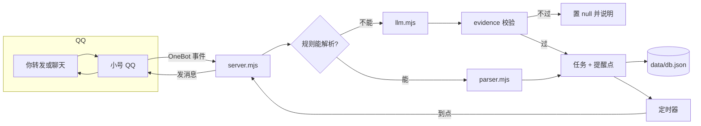

# 待办提醒 · todo-reminder

把群里的通知变成真的会响的提醒。

一个跑在自己服务器上的私人待办助手：你把学校群、工作群里的通知转发给一个小号 QQ，它把"12月5日19:00 高等数学在线考试"这样的文字变成结构化的待办和一组准时触发的提醒，到点主动私聊叫你。你也能直接跟它聊天来增删改——加一句"这场考试九点也提醒我一次"，它就真的加上。

**零第三方依赖**，只用 Node 内置模块。整套东西 6000 行左右，可以在一台 1.7G 内存的云服务器上跟着 QQ 一起跑。

---

## 它解决什么问题

现实里要记的事，大多不是"我要做的事"，而是"别人发在群里、我看到了、但我没有立即记下来"的事：

```
群消息：【高等数学】第 3 次平时测验定于 12月5日 19:00-20:30 在线进行，请提前 10 分钟进入
        ↓  截图转发给 bot 的小号 QQ
bot：   记下了：高等数学 第 3 次平时测验
        12/5 19:00–20:30
        提醒点：12/4 19:00 · 12/5 18:00 · 12/5 18:45 · 12/5 20:00
        ↓  到点
提醒：   【还剩半小时，检查一下进度】
```

不依赖任何第三方日历服务，数据全在自己的服务器上。

---

## 特点

**规则优先，模型兜底。** 解析分两层：先用 `rules/*.json` 做确定性解析（毫秒级、不联网、花钱为零），只在规则没把握时才交给大模型。规则能覆盖的场景永远走规则，所以常见通知的响应是瞬间的，而且结果可回归测试。

**每个时间点都必须有原文依据。** 这是整个项目最不可动摇的一条：模型给出的任何日期，都要能在原文里找到对应片段（`evidence`），校验不过就把这个时间点置为 `null` 并说明原因。宁可少记一条，也不在一个错的日子上准时叫你。模型最擅长的错误是"这周三"被它算成别的日子，这条约束就是为了拦住它。

**提醒点可以随时改。** 提醒不是写死的一串偏移量。任务上有 `extraReminders`（你临时加的点）和 `mutedReminders`（你取消的点），规则重排时原样保留。跟它说"这场考试十点也提醒我一次"，它调用 `update_task` 加一个点，**不会**复制出一条新任务。

**规则支持条件。** 比如考试：

```json
{ "anchor": "end", "before": "30m", "when": { "minDuration": 60 } }
```

只有时长 ≥60 分钟的考试才会在结束前半小时再响一次。20 分钟的小测不会被打扰。

**有长期记忆。** 待办存在 `db.json`，聊过的事存在 `memory.json`，两者分开——删掉任务不会连带清掉"他是谁"。它自己判断什么值得记（地名、称呼、人物对应关系），也支持"忘掉 XX"。群记忆按群隔离，别人在群里问它话时看不到你的私人记忆。

**零依赖。** 包括邮件告警：`src/mail.mjs` 用 `node:tls` 手写 SMTP 握手（EHLO / AUTH LOGIN / DATA），一百多行，没有 nodemailer。

---

## 架构



| 文件 | 职责 |
|---|---|
| `src/server.mjs` | HTTP 服务、QQ 事件处理、工具执行、定时器 |
| `src/parser.mjs` | 纯规则解析 + 提醒点展开（`expandReminders`） |
| `src/rules.mjs` | 规则加载与匹配 |
| `src/llm.mjs` | 模型调用、JSON 抽取、依据校验 |
| `src/agent.mjs` | 多轮工具调用循环 |
| `src/onebot.mjs` | OneBot HTTP 客户端、消息段解析 |
| `src/onebot-ws.mjs` | OneBot WebSocket 事件通道（带握手超时与退避重连） |
| `src/memory.mjs` | 长期记忆存取与注入 |
| `src/scheduler.mjs` | 到点触发 |
| `src/ics.mjs` | 导出 .ics 日历 |
| `src/mail.mjs` | 掉线告警邮件（手写 SMTP） |
| `src/websearch.mjs` | 联网搜索（官方 API + 网页抓取兜底） |

---

## 快速开始

需要 Node **20.6+**（用到了 `import.meta.dirname`）。

```bash
git clone https://github.com/wu75009-bot/todo-reminder.git todo-reminder
cd todo-reminder
mkdir -p data && cp config.example.json data/config.json
node src/server.mjs
```

打开 `http://127.0.0.1:3790` 就是管理页面：粘贴一段通知文字、或者拖一张截图进去，它会解析出待办和提醒点。

不配任何模型也能用——纯规则模式已经能处理格式规整的通知。想让它能读懂口语化的说法（"下周三下午那事儿"）、能聊天、能看图，再填 `llm.apiKey`。

---

## 配置

配置在 `data/config.json`。**这个文件里是明文密钥，不要外发，不要截图，不要提交到 git**（`.gitignore` 已经排除了整个 `data/`）。

```jsonc
{
  "llm": {
    "enabled": true,
    "model": "deepseek-flash",
    "apiKey": "sk-…",
    "baseUrl": "https://api.deepseek.com",
    "mode": "fallback",        // fallback = 规则没把握才用模型；always = 总是用
    "imageMode": "model",      // 图片先给模型直读，失败退回系统 OCR
    "effort": "high",          // 官方字段是 reasoning_effort
    "maxTokens": 3000          // 别设太小：思考过程也算在这个额度里
  },
  "qq": {
    "enabled": true,
    "api": "http://127.0.0.1:3000",  // NapCat 的 HTTP 接口，用来发消息
    "owner": "你的主号",
    "bot": "小号",
    "groups": [123456789]
  },
  "alert": {
    "enabled": true,
    "offlineMinutes": 10,
    "smtp": { "host": "smtp.qq.com", "port": 465, "pass": "邮箱授权码" }
  }
}
```

### 关于两个容易踩的坑

**`reasoning_effort` 不是 `effort`。** 写成 `effort` 接口不会报错，但会被静默忽略，于是你以为自己设了 `high`，其实一直是默认值。这个 bug 本项目的作者踩过。

**`max_tokens` 是思考 + 正文的总和。** 设成 1400 时，推理模型会先花掉大部分额度思考，答案从中间被截断（`finish_reason: "length"`），表现出来就是"它说一半就停了"。

---

## 部署到 Linux 服务器

想在手机上随时随地用，需要一台一直开着的机器。完整套件在 `deploy/linux/`：

```bash
# 1. 把机器人小号设成必填项，避免部署完才发现没配
sudo BOT_UIN=你的小号QQ bash deploy/linux/一键部署.sh
```

脚本会装 Node 22、Docker、拉起 NapCat 容器，并预置 OneBot 配置。之后：

1. 浏览器打开 `http://服务器IP:6099` 扫码登录小号（**只能用另一个号扫**）
2. 系统设置里有两个必须打开的开关：
   - **HTTP 服务器**（默认 3000）—— 我们调它发消息
   - **HTTP 上报 / WebSocket**（默认 3001）—— 它推事件给我们
   
   只配一个会出现"能收不能发"或"能发不能收"。

`deploy/linux/README.md` 里有 systemd 单元、swap 配置、以及排查清单。

### 几个实战教训

- **1.7G 内存要加 swap。** 容器里 QQ 的 Chromium 内核被 OOM 杀掉后，表现是"服务还 active 但一条消息都收不到"，而且重启后必须重新扫码。
- **WebSocket 必须有握手超时。** 容器先起、QQ 后登录时，docker-proxy 会接下 TCP 却不转发，连接既不 open 也不 close，于是永久卡住、永不重连。`onebot-ws.mjs` 里那个 `handshakeMs`（15 秒）就是这么来的，`_test-ws-hang.mjs` 是它的回归测试。
- **同一个 QQ 号不能两端同时在线。** 在别处登录会把服务器顶下线，恢复要重新扫码，腾讯还会发一条"异地登录"安全提醒。

---

## 设计上的几个决定

写在这里是因为它们看起来像"没做完整"，其实是权衡后的选择。

**system prompt 必须完全静态。** 日期、任务列表这些动态内容全部放进 user 消息。原因是 DeepSeek 的前缀缓存：system prompt 一变，缓存全 miss，每条消息都按全价计费。记忆也走 user 消息前缀（`【我记得的事】…【这轮消息】`），不进 system。

**宁可漏一条提醒，也不给一个错的时间。** 校验不过的时间点直接置 `null`，并在回复里说明原因。一个错的闹钟比没有闹钟更糟——你会信任它，然后在错误的日子空等。

**解析结果可回归。** `rules/` 是数据结构而不是代码，改了规则可以立刻用 `_test-alarms.mjs` 验算提醒点有没有算错。

**QQ 走 OneBot 而不是官方接口。** 官方机器人接口需要企业认证，个人号用不了。NapCat 是被广泛使用的 OneBot 实现。这属于灰色地带，账号可能被风控，请用自己的小号、并接受它可能周期性掉线。

---

## 测试

```bash
npm test                      # 解析 + 模型兜底 + QQ 链路
node _test-alarms.mjs         # 提醒点展开（含 60 分钟边界、缺失结束时间）
node _test-memory.mjs         # 记忆去重 / 删除 / 上限 / 群隔离
node _test-at.mjs             # @ 段解析
node _test-ics.mjs            # 日历导出
node _test-mail.mjs           # SMTP 失败路径（不需要真授权码）
node _test-ws-hang.mjs        # WebSocket 握手超时
```

大部分测试不需要真 API Key：`_mock-llm.mjs` 起一个本地假接口，把 `baseUrl` 指过去就行。端到端测试用独立数据目录（`TODO_DATA`），完全不碰你真实的 `data/`。

只影响 UI 的改动也要真打开看一眼——曾经有一次因为 `readFile` 漏了 `"utf8"`，首页返回 `{"type":"Buffer",...}`，接口全绿但页面根本打不开。

---

## 已知限制

- **重启 NapCat 必须重新扫码。** 没有可靠的会话恢复方式。所以运维原则是"别去重启它"，给容器配了 `restart: unless-stopped` 但别手动 `docker restart`。
- **个人号有被风控的风险。** 长期挂机房 + 频繁重登，腾讯会发安全提醒。技术上没有正当的绕过方法，越折腾越像黑产。
- **群聊接话会持续消耗额度。** 每条群消息都可能触发一次模型调用，建议收紧触发条件。
- **只在 Linux 和 Windows 上跑过。** macOS 应该也能跑（没用到平台相关 API 的地方都做了 `process.platform` 守卫），但没实际操作过。
- **OCR 依赖 Windows 的系统能力**，非 Windows 平台会跳过，图片直接走模型。

---

## License

MIT，见 [LICENSE](LICENSE)。
